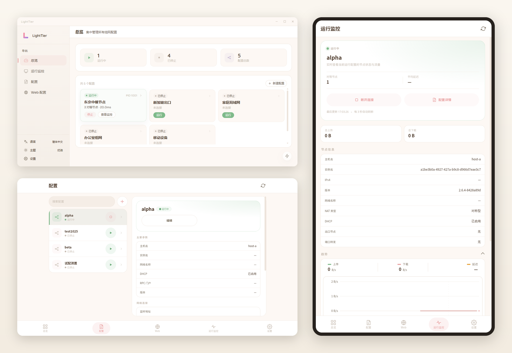

# LightTier

## Introduction

LightTier is a visual EasyTier manager built with Vue 3 + Tauri 2, available for Windows desktop and Android. It lets you create, import, and run EasyTier configurations through a graphical interface, and view network status and traffic trends in real time.

- Project: [github.com/BeafJerky/LightTier](https://github.com/BeafJerky/LightTier)
- Download: [GitHub Releases](https://github.com/BeafJerky/LightTier/releases)

### Screenshots

## Features

  - Visual configuration management: form and TOML code editing modes, with configuration import, templates, and advanced fields
  - One-click start/stop: port conflict pre-check before launching, with support for managing multiple configurations in parallel
  - Real-time monitoring: node and peer details, NAT type, and upload / download / latency trend charts
  - Kernel management: built-in compatible version list, on-demand EasyTier kernel download, and automatic mirror speed testing
  - Web configuration: connect to a remote config-server for centralized configuration distribution
  - Service management: install configurations as Windows services for auto-start (nssm or official CLI)
  - Exit node routing: automatically applies system routes when enabled, and cleans them up when stopped
  - Themes and languages: Cream / Dark / external themes, Simplified Chinese and English
  - More: system tray, auto-run on startup, lock-screen password, log cleanup, update check

## Interface Design

LightTier is designed to feel light, restrained, and customizable, so it stays comfortable during long monitoring sessions:

  - Light visual style: low-saturation cream background, soft rounded corners, and subtle shadows, with information grouped into cards
  - Theme system: built-in Cream and Dark themes plus external themes; switched at runtime via CSS variables and persisted across restarts
  - Responsive layout: sidebar and card grid on desktop, a single column with a bottom tab bar on phones, and a two-column layout in landscape (master-detail configuration, side-by-side charts)
  - Bilingual UI: switch between Simplified Chinese and English
  - Restrained motion: short easing for transitions and popovers without interrupting the current task

## Platforms

- Windows 10 / 11 (x64), with NSIS and MSI installers; administrator privileges are required at runtime
- Android 7.0+ (arm64)

Planned for the future: Linux, fnOS (Feiniu NAS), HarmonyOS, and macOS. No installers are available for these platforms yet; support will follow.

## Quick Start

1. Download the installer for your platform from [GitHub Releases](https://github.com/BeafJerky/LightTier/releases)
2. Install and launch LightTier
3. Create a configuration or import an existing EasyTier configuration, adjust the parameters as needed, and save it
4. Click "Run" to start the network, then check node status and traffic trends in "Monitor"

For configuration options, service installation, kernel management, and other details, refer to the corresponding pages inside the application.

## Dependencies

- [EasyTier](https://github.com/EasyTier/EasyTier): the decentralized networking kernel managed by LightTier

## License

This project is licensed under AGPL-3.0. See the LICENSE file in the repository for details.

## Contact

- Feedback: feel free to open an Issue or PR on [GitHub Issues](https://github.com/BeafJerky/LightTier/issues)
