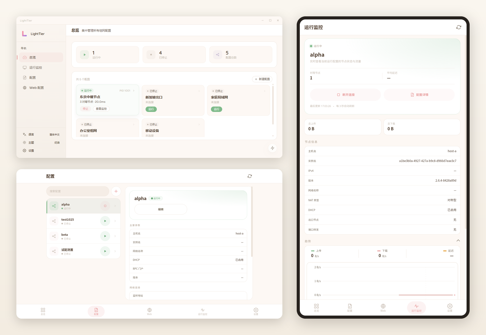

# LightTier

## 项目简介

LightTier 是一款基于 [EasyTier](https://github.com/EasyTier/EasyTier) 内核的可视化组网管理器，使用 Vue 3 + Tauri 2 构建，提供 Windows 桌面端与 Android 客户端。你可以通过图形界面完成 EasyTier 配置的创建、导入与运行，并在界面内实时查看网络状态与流量趋势。

- 项目地址：[github.com/BeafJerky/LightTier](https://github.com/BeafJerky/LightTier)
- 下载地址：[GitHub Releases](https://github.com/BeafJerky/LightTier/releases)

### 示例图片

## 项目特点

  - 可视化配置管理：表单 + TOML 代码双模式编辑，支持导入配置、模板与高级字段
  - 一键启停：启动前进行端口冲突预检，支持多个配置并行管理
  - 实时运行监控：节点与 Peer 详情、NAT 类型、上传 / 下载与延迟趋势图
  - 内核管理：内置兼容版本列表，按需下载安装 EasyTier 内核，镜像源自动测速
  - Web 配置管理：连接远程 config-server，集中管理下发配置
  - 服务管理：可将配置安装为 Windows 服务，实现开机自启（nssm / 官方 CLI 双模式）
  - 退出节点路由：启用后自动写入系统路由表，停止时自动清理
  - 主题与语言：奶油 / 暗色 / 外部主题，支持简体中文与 English
  - 其他：系统托盘、启动自动运行、锁屏密码、日志清理、检查更新

## 界面风格

LightTier 的界面按「轻盈、克制、可定制」设计，长时间挂着运行监控也不会有压迫感：

  - 轻盈视觉：低饱和奶油底色、柔和圆角与轻阴影，信息按卡片分层
  - 主题系统：内置奶油 / 暗色主题，支持外部主题；基于 CSS 变量热切换并持久化，无需重启
  - 响应式布局：桌面为侧边导航 + 卡片网格，手机为单列 + 底部标签栏，横屏自动切换双栏（配置主从、图表并排）
  - 双语界面：简体中文 / English 一键切换
  - 动效克制：过渡与弹层使用短时缓动，不打断当前操作

## 平台支持

- Windows 10 / 11（x64），提供 NSIS 与 MSI 安装包，运行时需要管理员权限
- Android 7.0+（arm64）

未来计划：Linux、飞牛 NAS（fnOS）、HarmonyOS、macOS。以上平台尚未发布安装包，将陆续适配。

## 快速上手

1. 从 [GitHub Releases](https://github.com/BeafJerky/LightTier/releases) 下载对应平台的安装包
2. 安装并启动 LightTier
3. 新建配置或导入已有 EasyTier 配置，按需调整参数后保存
4. 点击「运行」启动网络，在「运行监控」中查看节点状态与流量趋势

配置项说明、服务安装、内核管理等使用细节，请直接在软件内的对应页面查看。

## 依赖项目

- [EasyTier](https://github.com/EasyTier/EasyTier)：去中心化组网内核，也是 LightTier 管理的内核

## 许可证

本项目采用 AGPL-3.0 许可证，详情请见仓库中的 LICENSE 文件。

## 联系作者

- 问题反馈：欢迎在 [GitHub Issues](https://github.com/BeafJerky/LightTier/issues) 提交 Issue 和 PR
